<p align="center">
  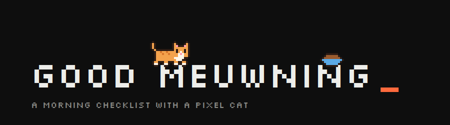
</p>

<p align="center"><i>Dont forget you morning routines, and dont forget to feed you cat!</i></p>

---

**Morning Routine** is a tiny desktop app for Linux and Windows that pops up every morning with your checklist,
helps you plan the day, keeps track of your hours and overtime, runs a pomodoro timer – and has a
pixel cat living on top of the title. The cat walks on the letters, hops over the spaces, naps,
eats lunch, chases butterflies and laser dots, hides in boxes and cheers when you check things off.

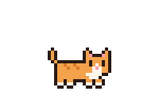

## What's inside

| | |
|---|---|
| ☀️ **Morning checklist** | Email, Jira, today's meetings, meeting prep and a plan for the day – plus your own routine items that come back every day. Drag the numbers to reorder; delete items under ⚙ (it asks twice). |
| 📝 **Plan for the day** | Write tasks as `- task` lines and check them off in the side panel. Unfinished tasks move to tomorrow. |
| ⏱ **Hours & overtime** | A reminder at 15:00 to log your hours; the overtime balance adds up for you. Weekends and days off expect 0 h, and you can fix past days under ⚙. |
| 🌦 **Weather** | Pick your city and today's weather shows under the date – and the cat tells you to take an umbrella. |
| 🔥 **Streaks** | Finish the whole list several working days in a row – the cat notices and unlocks things to wear. |
| 🍅 **Pomodoro** | Focus timer with adjustable lengths. The cat sleeps while you work, plays in short breaks and eats in the long one. |
| 🐈 **The cat** | Eight breeds including a big, fluffy Maine Coon, every color editable, your own looks saved as breeds (Maine Coon or not), a **random** button for a surprise cat, and you decide what it says. Your unsaved custom cat is kept while you try other breeds. |
| 🕗 **Your schedule** | Choose when the list opens, when you're reminded (and on which weekdays), when it saves & closes, and when the cat has lunch. On Windows and Flatpak the app starts quietly at login so it can open on time. |
| 💾 **Backup** | Export everything to one .zip, restore it later, and export your hours as CSV for your timesheet. |
| 🔄 **Updates** | The app tells you when a new version is out and updates itself with one click. |
| 🌗 **Light & dark** | Follows your system theme, or pick one. |
| 🇳🇴 **English & Norwegian** | Follows your system language, or pick one under ⚙. |

## Meet the cat

<table>
  <tr>
    <td align="center"><br><sub><b>walk</b><br>strolls along the letters</sub></td>
    <td align="center">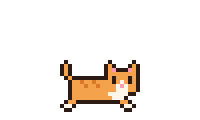<br><sub><b>play</b><br>chases the cursor</sub></td>
    <td align="center">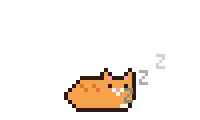<br><sub><b>sleep</b><br>the letters breathe with it</sub></td>
    <td align="center"><br><sub><b>sit</b><br>swats at the cursor</sub></td>
  </tr>
  <tr>
    <td align="center">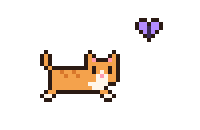<br><sub><b>butterfly</b><br>pounces on a butterfly</sub></td>
    <td align="center">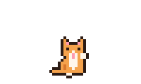<br><sub><b>groom</b><br>washes its paw</sub></td>
    <td align="center">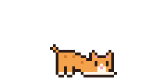<br><sub><b>stretch</b><br>a big morning stretch</sub></td>
    <td align="center">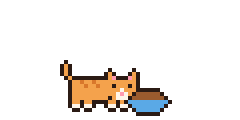<br><sub><b>eat</b><br>lunch – the bowl empties</sub></td>
  </tr>
  <tr>
    <td align="center">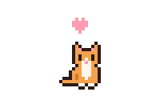<br><sub><b>♥</b><br>click the title</sub></td>
    <td align="center" colspan="3"><sub><b>jump</b> – hops between the words · <b>climb</b> – walks around the window frame<br><br>
    Scroll the title away and the cat climbs into the frame to keep you company.<br>
    It yawns in the morning and gets sleepy after 16:00.</sub></td>
  </tr>
</table>

And ten more tricks:

<table>
  <tr>
    <td align="center">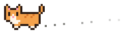<br><sub><b>zoomies</b><br>races back and forth</sub></td>
    <td align="center">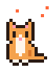<br><sub><b>tailchase</b><br>spins after its tail</sub></td>
    <td align="center">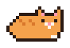<br><sub><b>loaf</b><br>turns into a bread loaf</sub></td>
    <td align="center">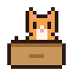<br><sub><b>box</b><br>peeks out of a box</sub></td>
    <td align="center">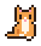<br><sub><b>knead</b><br>makes biscuits</sub></td>
  </tr>
  <tr>
    <td align="center"><br><sub><b>laser</b><br>hunts a laser dot</sub></td>
    <td align="center"><br><sub><b>wave</b><br>says hi!</sub></td>
    <td align="center">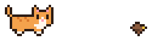<br><sub><b>bird</b><br>stalks a little bird</sub></td>
    <td align="center"><br><sub><b>roll</b><br>rolls over for belly rubs</sub></td>
    <td align="center">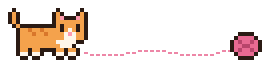<br><sub><b>yarn</b><br>bats a ball of yarn</sub></td>
  </tr>
</table>

That makes 19 animations, and the cat picks a new one every 15 minutes. Check something off and it says **good job!**

<p align="center">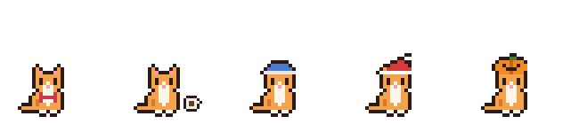<br>
<sub>bow tie (3 days in a row) · coffee cup (5) · beanie (10) · Santa hat in December · boo in Halloween week</sub></p>

<p align="center">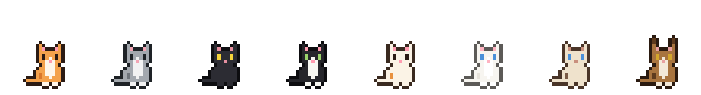<br>
<sub>orange tabby · grey tabby · black · tuxedo · calico · white · siamese · maine coon</sub></p>

<sub>Psst: try clicking the cat itself a few times in a row.</sub>


## Install

### Windows 10 / 11

Download **`MorningRoutine-Setup.exe`** from the
[latest release](https://github.com/tegn-co/Good-Meuwning-Routines/releases/latest) and run it.
It installs for your user only (no admin needed) and adds Morning Routine to the Start menu.
Windows may show a SmartScreen warning the first time, because the installer isn't code-signed –
click *More info → Run anyway*.

### Linux

One command – downloads the latest release and installs it:

```sh
curl -fsSL https://raw.githubusercontent.com/tegn-co/Good-Meuwning-Routines/main/install.sh | sh
```

On **Ubuntu 24.04+ and Debian** it installs the .deb (apt fetches everything else and asks for your
password once). On **any other Linux** with [Flatpak](https://flatpak.org/setup/) it installs the
Flatpak. Then open **Morning Routine** from the app menu.

<details>
<summary>Prefer to do it by hand?</summary>

Download a file from the [latest release](https://github.com/tegn-co/Good-Meuwning-Routines/releases/latest):

```sh
sudo apt install ./morgen-todo_all.deb            # Ubuntu / Debian
flatpak install --user ./morgen-todo.flatpak      # any Linux with Flatpak
```

Or read [`install.sh`](install.sh) first – it only picks one of these and installs it.
</details>

### Updating

The Windows and .deb versions check for new releases once a day and show a banner – click **update**
(on Linux you type your password; on Windows the installer runs and the app restarts). You can turn the
check off under ⚙. For the Flatpak, run the install command again. Your data stays where it is.

### First start


A short tutorial walks you through the app (with the cat, of course) and asks:

- how long your normal work day is
- how much overtime you already have
- when the list should open and when to remind you about hours
- whether to **pin Morning Routine to the dock**

Everything can be changed later under **⚙**, and the tutorial is there too.

## Your data stays yours

Every user starts with a fresh, local database – nothing is shared or uploaded. The only things the
app ever fetches are the weather (only the coordinates of the city you picked are sent to
[open-meteo.com](https://open-meteo.com), and only if you pick one) and the latest
version number from GitHub (Windows and .deb only, and you can turn it off).

| What | Windows | Linux .deb | Linux Flatpak |
|---|---|---|---|
| Checklist, plan, hours | `%LOCALAPPDATA%\Morning Routine\` | `~/.local/share/morgen-todo/` | `~/.var/app/no.zivid.MorgenTodo/data/morgen-todo/` |
| Settings (work day, schedule, cat, theme) | `%APPDATA%\Morning Routine\` | `~/.config/morgen-todo/` | `~/.var/app/no.zivid.MorgenTodo/config/morgen-todo/` |

Under **⚙ → backup** you can export everything to a single .zip, restore it later (or on another
machine), and export your hours as CSV for your timesheet.

Want the database somewhere else, e.g. on a network drive? Set `"db_path"` in `config.json` (in the
settings folder above) or the `MORGEN_TODO_DB` environment variable. Network drives (CIFS/NFS/SSHFS)
are detected and handled automatically.


## For developers


Run from source:

```sh
python3 app.py                 # the app
python3 app.py --cat=climb     # force an animation: walk, play, sleep, sit, jump, climb,
                               # butterfly, groom, stretch, eat, zoomies, tailchase, loaf,
                               # box, knead, laser, wave, bird, roll, yarn
python3 docs/make_art.py       # regenerate the pixel art in this README
```

Run the tests (they use temporary folders and never touch your real data):

```sh
python3 -m unittest discover -s tests -t . -v
```

Work on a branch (`feature/…`, `fix/…`, `docs/…`) and merge to `main` with `--no-ff` when the checks are green – every push runs the tests on Linux
and Windows, and changes to Windows files also build and test the Windows installer.

Release a new version – GitHub Actions runs the tests, builds the .deb, the .flatpak and the Windows
installer, checks that each one installs, and publishes the release. Nothing is released if a test fails:

```sh
git tag v1.7.0 && git push origin v1.7.0
```

Or build the packages locally:

```sh
./packaging/build-deb.sh 1.7.0      # -> packaging/dist/morgen-todo_1.7.0_all.deb
flatpak-builder --user --install build packaging/flatpak/no.zivid.MorgenTodo.yml
# Windows, in an MSYS2 UCRT64 shell with gtk4, libadwaita, python-gobject, python-cairo and pyinstaller:
packaging/windows/build.sh 1.7.0 && iscc /DAppVersion=1.7.0 packaging/windows/installer.iss
```

| File | |
|---|---|
| `app.py` | the app and its main window: list, plan, hours, settings, backup, updates |
| `cat.py` | the pixel cat, its animations, accessories and seasons |
| `cat_tricks.py` | ten extra animations (zoomies, box, laser, yarn …) |
| `cat_panel.py` | cat side panel: breed, colors, accessories and what the cat says |
| `pomodoro_panel.py` | pomodoro side panel |
| `database.py` | SQLite database, streaks, backup and CSV export |
| `schedule.py` | times for opening, reminders, auto close and lunch (systemd timers on the .deb, in the app on Flatpak and Windows) |
| `tutorial.py` | first-start tutorial and setup |
| `updater.py` | checks GitHub for new versions and installs them |
| `translations.py` | English and Norwegian texts |
| `platforms.py` | what differs between Linux and Windows (folders, reminders, start at login, fonts) |
| `weather.py` | today's weather from Open-Meteo, with pixel icons |
| `tests/` | unit and app tests |
| `packaging/` | .deb build script, Flatpak manifest, Windows installer, icon generator, fonts |
| `docs/` | README art |

Fonts: [Silkscreen](https://github.com/googlefonts/silkscreen) and
[JetBrains Mono](https://github.com/JetBrains/JetBrainsMono), both under the SIL Open Font License 1.1.

<p align="center"><br><sub>now go feed your cat</sub></p>
